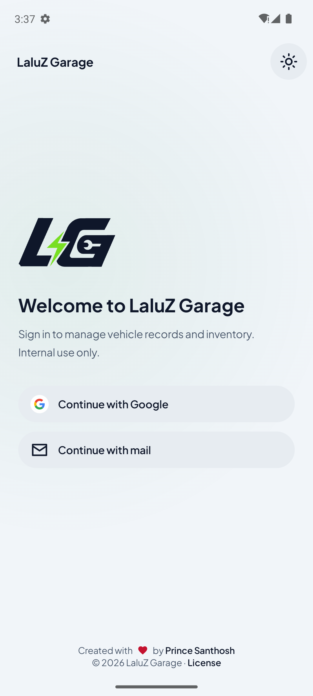
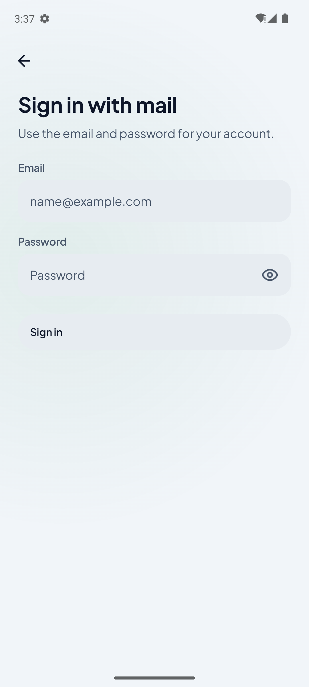
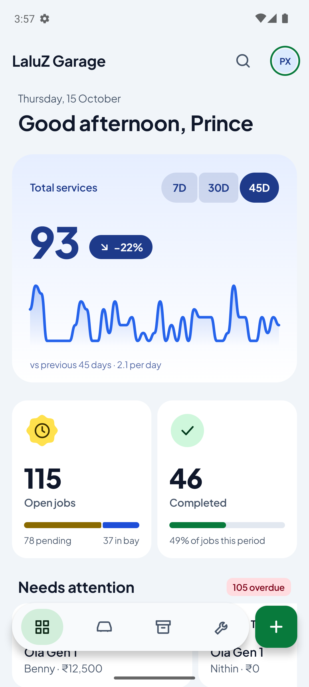
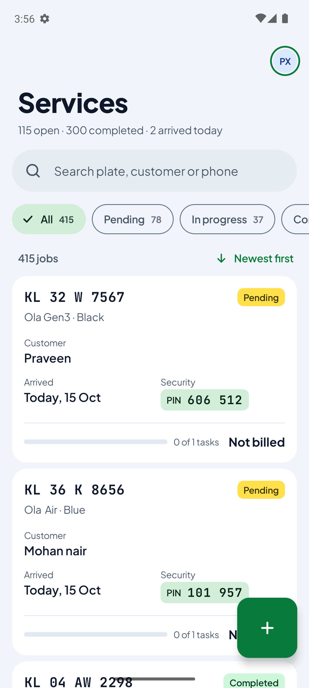
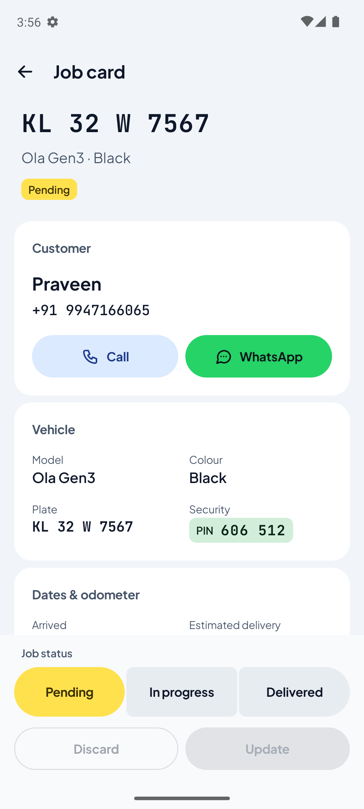
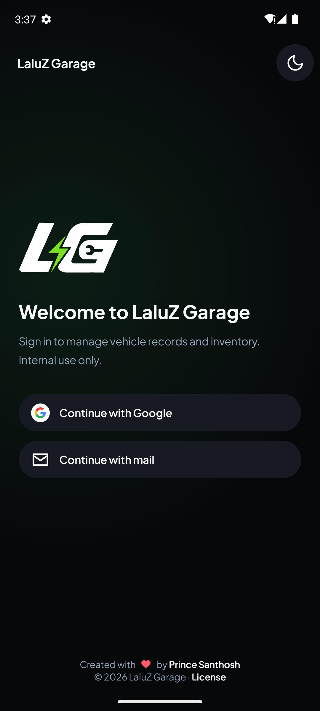
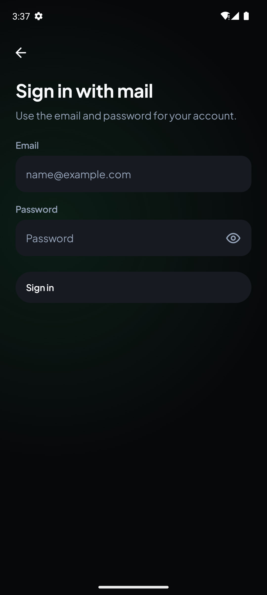
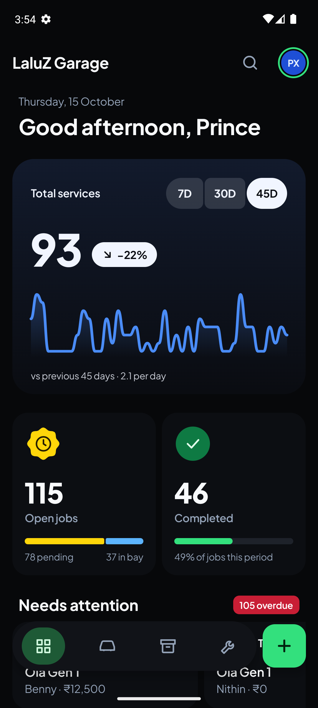
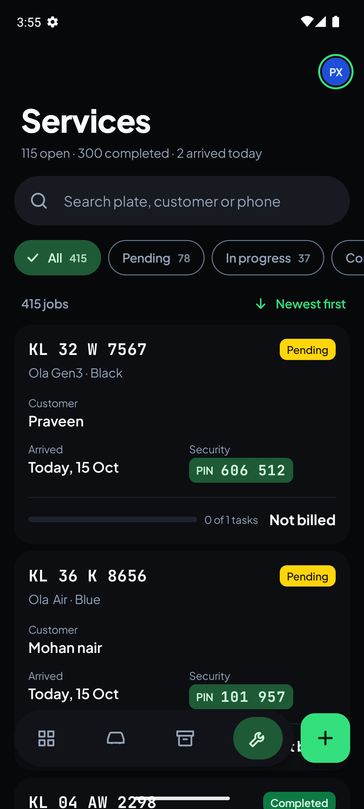
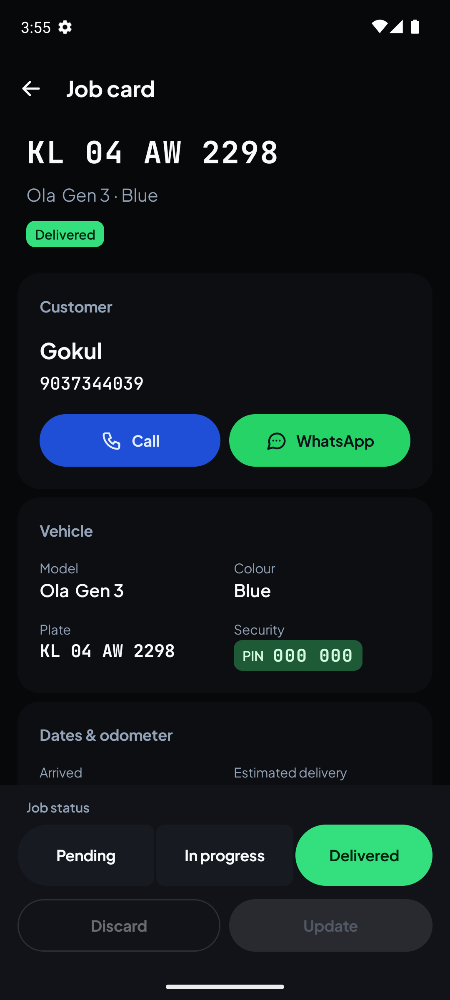

# LaluZ Garage

Workshop management for vehicle service centres: customers, vehicles, job cards, spare-parts inventory, billing and WhatsApp notifications. Backed entirely by Firebase Authentication and Cloud Firestore; there is no application server.

---

## Contents

1. [Applications](#1-applications)
2. [Screenshots](#2-screenshots)
3. [Features](#3-features)
4. [Architecture](#4-architecture)
5. [Data model](#5-data-model)
6. [Sources](#6-sources)
7. [File structure](#7-file-structure)
8. [Development environment](#8-development-environment)
9. [Deployment](#9-deployment)
10. [Security](#10-security)
11. [License](#11-license)

---

## 1. Applications

| Application | Path | Stack | Target |
| :--- | :--- | :--- | :--- |
| Web app | `src/` | React 19, TypeScript, Vite, Tailwind CSS v4 | Browser (desktop and mobile layouts) |
| Android (Capacitor) | `android/` | Capacitor 8 wrapping the web build (`dist/`) | minSdk 24, targetSdk 36, compileSdk 37 |
| Android (native) | `compose-app/` | Kotlin, Jetpack Compose, Material 3 Expressive, Hilt | minSdk 26, targetSdk 35, compileSdk 37 |

All three share one Firebase project and the same Firestore schema. Both Android builds use the application ID `dev.appu.laluzgarage`, so only one can be installed on a device at a time.

---

## 2. Screenshots

Native Android app, captured during device testing ([`compose-app/design-qa/`](compose-app/design-qa/)).

| Sign in | Sign in (email) | Dashboard | Services | Job card |
| :---: | :---: | :---: | :---: | :---: |
|  |  |  |  |  |
|  |  |  |  |  |

---

## 3. Features

| Feature | Description |
| :--- | :--- |
| Authentication | Google sign-in and email/password. New accounts wait for an admin to assign a role. |
| Dashboard | Service totals with a trend sparkline (45 days on web; 7 / 30 / 45-day ranges on native), open vs. completed jobs, overdue jobs. |
| Vehicle intake | PIN-gated, three-step wizard: customer → vehicle → job specification. |
| Services | Job cards with status, task checklist, parts allocation, labour charge and computed total. |
| Vehicles | Vehicle registry with per-vehicle service history and lifetime spend. |
| Inventory | Parts with category, price, stock count, minimum stock level and shelf location. |
| WhatsApp | Templated intake and delivery messages opened through `wa.me` links. |
| Analytics (web) | Revenue, job flow, turnaround, technician, client spend, fleet, inventory, invoice tiers, retention, service categories, vehicle health and workload heatmap. |
| Settings | Accounts and roles (admin only), general, WhatsApp templates, tags, date-wise history, system, statistics, app updates. |
| Theming | Light and dark themes in all apps. |
| OTA updates (Android) | Download and install APKs from GitHub Releases on a stable or dev channel. |

---

## 4. Architecture

### 4.1 Overview

```text
Web app ─────────────┐
Android (Capacitor) ─┼──► Firebase Authentication
Android (native) ────┘    Cloud Firestore  ◄── firestore.rules
```

Clients call Firebase directly. Authorization is enforced only by `firestore.rules`; anyone holding the client config can call Firestore without the UI, so the rules are the security boundary.

**Data loading:**

- **Web:** most views load collections with one-shot `getDocs` reads and reload after writes. The signed-in user's profile (`users/{uid}`) and the parts list use `onSnapshot` listeners.
- **Native Android:** repositories use Firestore snapshot listeners with a 100 MB persistent disk cache (`PersistentCacheSettings`). Data is available offline, and offline writes are queued until the device reconnects. `SyncManager` drives a top-bar sync indicator on cold start and on pull-to-refresh.

### 4.2 Authentication and roles

**Sign-in**

- Web: `signInWithPopup` with Google, falling back to `signInWithRedirect` when popups are blocked; `signInWithEmailAndPassword` for email.
- Capacitor: `@capacitor-firebase/authentication` performs native Google sign-in, then the ID token is passed to the web SDK via `signInWithCredential`.
- Native: Credential Manager (Google ID) and `signInWithEmailAndPassword`.

**Profile sync** (`syncUserProfile` in `src/contexts/AuthContext.tsx`, `AuthRepository.kt` in the native app):

1. Read `users/{uid}`.
2. If missing, look for a pre-registered profile with the same email (lowercased). If found, copy it to `users/{uid}` and delete the old document.
3. Otherwise create `users/{uid}` with `status: offline` and `tags: []` (no role).
4. **Zero-admin bootstrap:** if the user has no role, query `users` for `role == 'admin'`, then for `tags array-contains 'admin'` (both `limit(1)`). If neither returns a document, write `settings/admin_lock` and promote the user to `role: 'admin'`.

A user without a role sees the **Pending approval** screen.

**Role resolution** (same order in `src/types.ts` and `firestore.rules`):

1. `role` field: `admin`, `technician` or `assistant`.
2. Legacy `tags`: `admin` → admin; `tech` or `technician` → technician; `assistant` → assistant.
3. Otherwise unassigned.

The rules also treat a custom auth claim `admin == true` as admin.

**Permissions** (from `firestore.rules`):

| Collection | Read | Create | Update | Delete |
| :--- | :--- | :--- | :--- | :--- |
| `customers`, `vehicles`, `serviceRecords` | any role | technician, assistant, admin | technician, admin | admin |
| `parts` | any role | technician, admin | technician, admin | admin |
| `settings/*` | any role | admin (`admin_lock`: only while it does not exist) | admin | admin |
| `users/{uid}` | any signed-in user | self or admin | admin; self only if `role` and `tags` are unchanged | admin, not self |
| everything else | denied | denied | denied | denied |

`createdAt` is immutable on update. Referenced IDs must match `^[a-zA-Z0-9_\-]+$` and be at most 128 characters.

### 4.3 Vehicle intake

1. **Advisor PIN (4 digits).** Checked in order: any user whose `pin` matches; the signed-in user's own `pin`, or `1234` (`DEFAULT_ADVISOR_PIN`) if they have none; `1234` when no users are loaded.
2. **Customer.** Search existing customers or create one inline.
3. **Vehicle.** Select one of the customer's vehicles or register a new one (make, model, colour, plate, key or PIN).
4. **Job.** Odometer reading (or *unknown mileage* / *dead vehicle*), tasks, personal belongings, remarks, expected delivery date.
5. A `serviceRecords` document is created with `status: 'pending'` and `laborCost`, `partsCost`, `totalCost` set to `0`. The intake WhatsApp message is offered.

The web app stores an unfinished intake in `sessionStorage` (`laluz_service_intake_draft`). It survives a reload and is cleared on submit or when the tab closes.

### 4.4 Job cards, billing and stock

Statuses: `pending` → `in-progress` → `completed`, or `cancelled`.

```text
partsCost = Σ (unitPrice × quantity)   over partsUsed[]
totalCost = laborCost + partsCost
```

Saving a job runs a single Firestore transaction (`useServiceHistory.ts`):

1. Read the stored record and every referenced part.
2. Return the previously used quantities to stock.
3. Deduct the new quantities. If any part would go below zero, abort with `Insufficient stock for <part>`.
4. Write the new stock levels and the updated record.

Deleting a job returns its parts to stock in the same way before removing the record.

- **Overdue:** status is `pending` or `in-progress` and `expectedDeliveryDate` is in the past. Cards show *Due Today*, *N Days Left* or *N Days Overdue*.
- **Low stock:** `stockQuantity <= minStockLevel` (default `5`).
- **Locale:** currency INR (₹); phone numbers are normalised to `+91`.

### 4.5 WhatsApp templates

Messages open as `https://wa.me/<phone>?text=<urlencoded message>`. The intake and delivery templates are stored at `settings/whatsapp` (`intakeTemplate`, `deliveryTemplate`) and cached in `localStorage`. Defaults live in `src/services/whatsappPresetService.ts`.

| Placeholder | Value | Templates |
| :--- | :--- | :--- |
| `{customer_name}` | Customer name | intake, delivery |
| `{vehicle_make}` | Make | intake, delivery |
| `{vehicle_model}` | Model | intake, delivery |
| `{vehicle_plate}` | Plate number | intake, delivery |
| `{job_description}` | Job tasks | intake, delivery |
| `{vehicle_title}` | Make and model | delivery |
| `{parts_list}` | Parts used with quantities | delivery |
| `{labor_cost}` | Formatted labour charge | delivery |
| `{total_cost}` | Formatted total | delivery |

### 4.6 OTA updates (Android)

1. `GET https://api.github.com/repos/nmhappu/laluzgarage/releases`.
2. Filter by channel (default `stable`, stored in `localStorage` key `laluz_ota_channel`):
   - `stable`: not a draft, not a pre-release, and the tag has no `-dev`, `-alpha`, `-beta`, `-canary` or `-rc`. Falls back to any non-draft release if none match.
   - `dev`: any non-draft release.
3. Take the newest release with an `.apk` asset and compare it to the installed `versionName` using semver. A version without a pre-release suffix ranks above the same version with one.
4. Download and install through the system package installer. This requires `REQUEST_INSTALL_PACKAGES`.

Implementations: `src/services/otaUpdateService.ts` with the native plugin `android/app/src/main/java/dev/appu/laluzgarage/OtaUpdaterPlugin.kt` (Capacitor), and `compose-app/.../data/update/AppUpdater.kt` (native). The web app checks 2.5 s after sign-in when auto-check is on.

### 4.7 Runtime configuration (web)

`getEnv(key)` in `src/lib/env.ts` returns the first non-empty value from:

1. `window.__ENV__[key]`, written by the container at start-up into `/env-config.js`
2. `window.__ENV__[key without the VITE_ prefix]`
3. `import.meta.env[key]`, inlined by Vite at build time
4. the supplied default

One image can therefore serve any Firebase project without a rebuild. The Firestore database ID defaults to `(default)`.

### 4.8 Build-time colour sync

The `sync-colours` plugin in `vite.config.ts` reads `src/styles/colours.xml` on `buildStart` and rewrites the matching CSS variables in `src/index.css` (dark, `[data-theme="light"]` and `@theme` blocks). Edit colours in the XML file.

---

## 5. Data model

Types are defined in `src/types.ts` (web) and `data/model/` (native). Validation comes from `firestore.rules`.

| Path | Fields | Rule validation |
| :--- | :--- | :--- |
| `customers/{id}` | `name`, `phone`, `technicianId`, `createdAt`, `updatedAt` | `name` 1–100 chars, `phone` 1–30 chars |
| `vehicles/{id}` | `customerId`, `make`, `model`, `color`, `plateNumber`, `passwordOrPin`, `technicianId`, `createdAt`, `updatedAt` | `make` 1–50, `plateNumber` 1–30, valid `customerId` |
| `parts/{id}` | `name`, `category`, `stockQuantity`, `price`, `minStockLevel`, `location`, `createdAt`, `updatedAt` | `name` 1–100, `stockQuantity` int ≥ 0, `price` ≥ 0, optional `sku` ≤ 50 |
| `serviceRecords/{id}` | `vehicleId`, `customerId`, `technicianId`, `technicianName`, `date`, `expectedDeliveryDate`, `mileage`, `completionMileage`, `isDeadVehicle`, `isUnknownMileage`, `personalItems`, `description`, `remarks`, `finalRemarks`, `status`, `laborCost`, `partsCost`, `totalCost`, `partsUsed[]`, `createdAt`, `updatedAt` | valid `status`, costs ≥ 0, `remarks` / `finalRemarks` ≤ 2000 |
| `users/{uid}` | `name`, `email`, `photoURL`, `status`, `role`, `pin`, `tags[]`, `createdAt`, `updatedAt` | `status` ∈ {online, offline}, `role` ∈ {admin, technician, assistant}, `pin` ≤ 10 chars |
| `settings/whatsapp` | `intakeTemplate`, `deliveryTemplate`, `updatedAt` | admin write |
| `settings/admin_lock` | `adminUid`, `adminEmail`, `bootstrappedAt` | write once while absent |

`partsUsed[]` items: `{ partId, name, quantity, unitPrice }`.

---

## 6. Sources

### 6.1 Web and Capacitor (`package.json`)

| Purpose | Package | Version |
| :--- | :--- | :--- |
| UI | [react](https://react.dev/), react-dom | `^19.3.1` |
| Routing | [react-router-dom](https://reactrouter.com/) | `^7.18.4` |
| Language | [typescript](https://www.typescriptlang.org/) | `~5.8.2` |
| Build / dev server | [vite](https://vitejs.dev/), @vitejs/plugin-react | `^8.3.4`, `^6.1.2` |
| Styling | [tailwindcss](https://tailwindcss.com/), @tailwindcss/vite | `^4.3.3` |
| Animation | [motion](https://motion.dev/) | `^13.5.1` |
| Charts | [echarts](https://echarts.apache.org/) | `^6.1.0` |
| Firebase | [firebase](https://firebase.google.com/docs/web/setup) | `^12.19.0` |
| Native runtime | [@capacitor/core, android, cli](https://capacitorjs.com/) | `^8.5.3` |
| Native auth | [@capacitor-firebase/authentication](https://github.com/capawesome-team/capacitor-firebase) | `^8.5.2` |
| Native plugins | @capacitor/app, status-bar, splash-screen | `^8.1.2`, `^8.0.4`, `^8.0.2` |
| Components | [radix-ui](https://www.radix-ui.com/), @radix-ui/react-select, [@material/web](https://github.com/material-components/material-web) | `^1.8.1`, `^2.4.1`, `^2.5.0` |
| Icons | [lucide-react](https://lucide.dev/), [Material Symbols](https://fonts.google.com/icons) | `^1.57.0`, Google Fonts |
| Numbers | [@number-flow/react](https://number-flow.barvian.me/) | `^0.6.2` |
| Dates | [date-fns](https://date-fns.org/) | `^4.4.0` |
| Class utilities | class-variance-authority, clsx, tailwind-merge | `^0.7.1`, `^2.1.1`, `^3.7.0` |
| Tests | [vitest](https://vitest.dev/), [@firebase/rules-unit-testing](https://firebase.google.com/docs/rules/unit-tests) | `^5.0.4`, `^5.0.2` |
| Lint | [eslint](https://eslint.org/), typescript-eslint, @firebase/eslint-plugin-security-rules | `^10.12.0`, `^8.71.2`, `^0.0.2` |

Fonts (Google Fonts): Google Sans, Google Sans Text, Plus Jakarta Sans, JetBrains Mono.

The production build splits vendor code into `vendor-react`, `vendor-firebase`, `vendor-charts` and `vendor-ui` chunks.

### 6.2 Native Android (`compose-app/gradle/libs.versions.toml`)

| Purpose | Library | Version |
| :--- | :--- | :--- |
| Language | Kotlin, KSP | `2.4.21`, `2.3.12` |
| Build | Android Gradle Plugin | `9.4.1` |
| UI | Compose BOM | `2026.09.00` |
| Components | Material 3 (pinned above BOM for Expressive) | `1.5.0-beta01` |
| Navigation | Navigation Compose | `2.10.2` |
| DI | Hilt, Hilt Navigation Compose | `2.60.1`, `1.4.0` |
| Firebase | Firebase BOM (Auth, Firestore) | `35.0.1` |
| Google sign-in | Credential Manager, Google ID, Play Services Auth | `1.5.0`, `1.1.1`, `21.3.0` |
| Images | Coil | `2.7.0` |
| Concurrency | kotlinx-coroutines | `1.11.0` |
| Startup | Baseline Profile, ProfileInstaller | `1.5.0`, `1.4.1` |

Bundled fonts (`res/font/`): Google Sans Flex, Plus Jakarta Sans, JetBrains Mono (OFL, `assets/licenses/JetBrainsMono-OFL.txt`).

### 6.3 External services

| Service | Use |
| :--- | :--- |
| Firebase Authentication | Google and email/password sign-in |
| Cloud Firestore | Application data |
| GitHub Releases API | OTA update metadata and APK downloads |
| WhatsApp (`wa.me`) | Customer messages |
| GitHub Container Registry | Docker image `ghcr.io/nmhappu/laluzgarage` |

### 6.4 Related documents

| File | Content |
| :--- | :--- |
| [`compose-app/DESIGN_SYSTEM.md`](compose-app/DESIGN_SYSTEM.md) | Native design tokens: colour roles, type, shape, spacing, motion |
| [`compose-app/MIGRATION_PLAN.md`](compose-app/MIGRATION_PLAN.md) | Capacitor → native Compose migration plan |
| [`compose-app/SECURITY_REVIEW.md`](compose-app/SECURITY_REVIEW.md) | Security review of the native app and Firestore rules |
| [`security_spec.md`](security_spec.md) | Data invariants and adversarial payloads for the rules |

---

## 7. File structure

```text
laluzgarage/
├── src/                            Web app
│   ├── main.tsx                    Entry point
│   ├── App.tsx                     Routes, layout shell, OTA check
│   ├── index.css                   Theme variables, fonts, Tailwind config
│   ├── types.ts                    Domain types and role resolution
│   ├── components/
│   │   ├── analytics/              Analytics view, chart cards, detail pages
│   │   ├── auth/                   Login, pending approval, loading screen
│   │   ├── dashboard/              Stat cards, sparkline, recent activity
│   │   ├── intake/                 Advisor PIN, intake steps 1–3
│   │   ├── inventory/              Parts list, part form, delete dialog
│   │   ├── nav/                    Desktop rail, mobile top/bottom bars
│   │   ├── services/               Job cards, edit sheet, delivery bill
│   │   ├── settings/               Settings pages
│   │   ├── shared/                 Search bar, status badge, WhatsApp popup, update prompt
│   │   ├── ui/                     Primitives: button, select, calendar, logo
│   │   └── vehicle/                Vehicle cards, form, ledger drawer
│   ├── contexts/                   AuthContext, ThemeContext, UIContext
│   ├── hooks/                      Data loading and view logic per screen
│   ├── lib/                        Firebase init, env resolver, utils, analytics calculators
│   ├── services/                   WhatsApp presets, inventory, contacts (vCard), OTA
│   └── styles/colours.xml          Colour source synced into index.css
├── public/                         env-config.js stub, static assets
├── index.html                      HTML shell
├── android/                        Capacitor Android project
│   └── app/src/main/java/dev/appu/laluzgarage/
│       ├── MainActivity.kt
│       └── OtaUpdaterPlugin.kt     APK download/install plugin
├── compose-app/                    Native Android project
│   ├── app/src/main/java/dev/appu/laluzgarage/
│   │   ├── data/                   model, repository, sync, update
│   │   ├── di/                     Hilt module (Firebase, cache settings)
│   │   └── ui/                     auth, components, dashboard, intake, inventory,
│   │                               navigation, services, settings, theme, vehicles
│   ├── baselineprofile/            Baseline profile generator
│   ├── design-qa/                  Device test screenshots
│   └── gradle/libs.versions.toml   Version catalog
├── docker/
│   ├── 40-generate-env.sh          Writes env-config.js at container start
│   └── default.conf.template       Nginx config (envsubst for PORT, SERVER_NAME)
├── .github/
│   ├── workflows/                  docker-publish.yml, release.yml
│   └── dependabot.yml
├── firestore.rules                 Security rules
├── firestore.rules.test.ts         Rules tests (emulator)
├── capacitor.config.ts             Capacitor config
├── vite.config.ts                  Vite config and colour sync plugin
├── Dockerfile                      Multi-stage build: Node → Nginx
├── compose.example.yml             Docker Compose template
├── nginx.conf                      Static Nginx config (port 2266)
├── deploy.ps1                      install → build → cap sync android
├── .env.example                    Environment template
└── package.json
```

---

## 8. Development environment

### 8.1 Requirements

| Tool | Version | Used by |
| :--- | :--- | :--- |
| Node.js | ≥ 20 (Dockerfile: 20, CI: 22) | Web, Capacitor |
| npm | bundled with Node.js | Web, Capacitor |
| JDK | 21 (`sourceCompatibility` / `jvmToolchain`) | Both Android projects |
| Gradle | 9.8.1 via wrapper | Both Android projects |
| Gradle daemon JVM | 21 (`android/`), 25 (`compose-app/`); auto-provisioned from `gradle-daemon-jvm.properties` | Both Android projects |
| Android SDK | Platform 37 | Both Android projects |
| Docker | — | Container build and run |
| Firebase CLI | — | Firestore emulator for rules tests (optional) |

### 8.2 Firebase project

1. Enable Authentication with the **Google** and **Email/Password** providers.
2. Create a Firestore database. The native app uses the named database `ai-studio-68b1ba2c-7611-4e4f-b6eb-ac12f212fa4e` (hard-coded as `FIRESTORE_DATABASE_ID` in `compose-app/.../di/AppModule.kt`, and the default in `compose.example.yml`). The web app uses `VITE_FIREBASE_FIRESTORE_DATABASE_ID`, falling back to `(default)`.
3. Deploy `firestore.rules` to that database.
4. Register a Web app (for the `.env` values) and an Android app with package `dev.appu.laluzgarage` (for `google-services.json`).

### 8.3 Web app

```bash
git clone https://github.com/nmhappu/laluzgarage.git
cd laluzgarage
npm install
cp .env.example .env
npm run dev
```

The dev server listens on `0.0.0.0:3000`.

| Variable | Description | Default |
| :--- | :--- | :--- |
| `VITE_FIREBASE_API_KEY` | Web API key | required |
| `VITE_FIREBASE_AUTH_DOMAIN` | `<project>.firebaseapp.com` | required |
| `VITE_FIREBASE_PROJECT_ID` | Project ID | required |
| `VITE_FIREBASE_STORAGE_BUCKET` | `<project>.firebasestorage.app` | required |
| `VITE_FIREBASE_MESSAGING_SENDER_ID` | Sender ID | required |
| `VITE_FIREBASE_APP_ID` | Web app ID | required |
| `VITE_FIREBASE_FIRESTORE_DATABASE_ID` | Firestore database ID | `(default)` |
| `DISABLE_HMR` | `true` disables Vite HMR | `false` |
| `PORT` | Container listen port | `2266` |
| `SERVER_NAME` | Nginx `server_name` | `localhost` |

In containers, each `VITE_FIREBASE_*` variable can also be given as `FIREBASE_*`.

| Script | Command |
| :--- | :--- |
| `dev` | `vite --port=3000 --host=0.0.0.0` |
| `build` | `vite build` → `dist/` |
| `preview` | `vite preview` |
| `clean` | `rm -rf dist` |
| `test` | `vitest run src/lib/` |
| `lint` | `eslint . && tsc --noEmit` |
| `docker:build` | `docker build -t laluzgarage .` |
| `docker:run` | `docker run -p 2266:2266 --env-file .env laluzgarage` |
| `mobile:build` | `npm run build && npx cap copy` |
| `mobile:sync` | `npm run build && npx cap sync` |
| `mobile:open` | `npx cap open android` |

`firestore.rules.test.ts` is not included in `npm run test`. It requires the Firestore emulator on `localhost:8080`.

### 8.4 Android (Capacitor)

1. Place `google-services.json` in `android/app/` (template: `google-services.json.example`). Without it the Google Services plugin is skipped.
2. Build and sync, then open in Android Studio:
   ```bash
   npm run mobile:sync
   ```
   ```bash
   npm run mobile:open
   ```

`capacitor.config.ts`: `webDir: dist`, splash background `#07080A` with manual hide, status bar overlays the WebView, and native Firebase Auth with the `google.com` provider. `deploy.ps1` runs `npm install`, `npm run build` and `npx cap sync android`.

### 8.5 Android (native)

1. Place `google-services.json` in `compose-app/app/`. The Google Services plugin is always applied, so the build fails without it.
2. Build:
   ```bash
   cd compose-app && ./gradlew assembleDebug
   ```
   The output is in `compose-app/app/build/outputs/apk/debug/`.

Release builds enable R8 minification and resource shrinking and ship the baseline profile from `app/src/release/generated/baselineProfiles/`. Pass `-PcomposeReports` to write Compose compiler stability reports to `build/compose_reports`.

### 8.6 CI/CD

| Workflow | Trigger | Output |
| :--- | :--- | :--- |
| `docker-publish.yml` | push / PR to `main` or `master`, tags `v*.*.*`, manual | Multi-arch image (`linux/amd64`, `linux/arm64`) pushed to GHCR, except on PRs. Tags: `latest` (default branch), semver, branch, tag, short SHA. |
| `release.yml` | tags `v*`, manual (channel, tag, notes) | Node 22 build → `cap sync android` → JDK 21 `assembleDebug` → GitHub Release with `laluzgarage-<channel>-<tag>.apk`. Tags containing `-dev`, `-alpha`, `-beta`, `-canary` or `-rc` are published as pre-releases on the `dev` channel. |
| `dependabot.yml` | monthly | npm production dependency updates (max 10 open PRs) |

`release.yml` builds and releases `android/` (Capacitor) only. `compose-app/` has no CI workflow.

---

## 9. Deployment

The `Dockerfile` is multi-stage: `node:20-alpine` runs `npm ci` and `npm run build`, and `nginx:alpine` serves `dist/`. At start-up, `docker/40-generate-env.sh` writes every `VITE_*` and `FIREBASE_*` environment variable into `/usr/share/nginx/html/env-config.js`, and Nginx renders `default.conf.template` with `PORT` and `SERVER_NAME`.

Nginx serves the SPA with `try_files … /index.html`, gzip, security headers (CSP, `X-Frame-Options: DENY`, `nosniff`, Referrer-Policy, Permissions-Policy), `no-store` on `env-config.js` and one-year immutable caching on `/assets/`. A health check fetches `/` every 30 s.

**Docker Compose**

```bash
cp compose.example.yml compose.yml
```
```bash
docker compose up -d
```

**Docker CLI**

```bash
docker run -d --name laluzgarage -p 2266:2266 --env-file .env --restart unless-stopped ghcr.io/nmhappu/laluzgarage:latest
```

The app is served on `http://localhost:2266`.

---

## 10. Security

- `firestore.rules` is the only access control. Deploy it together with any client change that touches the schema.
- `.env` and `google-services.json` are git-ignored. Do not commit them.
- Open findings, including role self-assignment, staff PINs readable by any signed-in account, and the bootstrap path when `settings/admin_lock` is missing, are documented in [`compose-app/SECURITY_REVIEW.md`](compose-app/SECURITY_REVIEW.md).

---

## 11. License

GNU Affero General Public License v3.0. See [`LICENSE`](LICENSE).

Copyright © 2026 Prince Santhosh.
